# DemandIQ

**AI-powered demand forecasting for food service operators** — predict demand, prevent
waste, and grow with confidence.

DemandIQ is a full-stack monorepo that takes messy, handwritten and manual demand
records and turns them into decisions a food service operator can act on: a LightGBM
forecast with statistically valid uncertainty intervals, plain-language explanations
of *why* a number moved, policy simulation for "what if we change this", and drift
monitoring that admits when the model has stopped being trustworthy.

[](https://github.com/kelvintawe12/DemandIQ)
[](backend/API_ENDPOINTS.md)
[](frontend/src/__tests__)
[](#license)

**Repository:** <https://github.com/kelvintawe12/DemandIQ>


**Video demo:** <https://drive.google.com/drive/folders/1w_Qtq6P1c3YwbjR1ygGxMKzfW-YHPcjl?usp=sharing>

---

## Table of contents

- [Description](#description)
- [Screenshots](#screenshots)
- [UI design](#ui-design)
- [Frontend code](#frontend-code)
- [Backend code](#backend-code)
- [Database schema and data model](#database-schema-and-data-model)
- [ML model and notebook](#ml-model-and-notebook)
- [Architecture](#architecture)
- [Tech stack](#tech-stack)
- [Project structure](#project-structure)
- [Code files](#code-files)
- [Setup](#setup)
- [Deployment plan](#deployment-plan)
- [Testing](#testing)
- [Documentation](#documentation)

---

## Description

DemandIQ solves a specific, unglamorous problem: small and mid-sized food service
operators write down what they sold — often on paper, in a notebook, then retyped
into a spreadsheet — and then guess what to cook tomorrow. Guessing wrong in one
direction means waste and thin margins; guessing wrong in the other means running out
and turning away customers.

The platform covers the whole loop:

| Capability | What it does |
| --- | --- |
| **Demand ingestion** | Manual entry, CSV/XLSX upload, and OCR for handwritten logs, normalised and de-duplicated into a single fact table. |
| **Forecasting** | LightGBM (CatBoost as an alternative primary) with Mondrian adaptive conformal intervals, so an interval means something per location and per demand quantile rather than one global number. |
| **Explainability** | SHAP-based explanations and per-driver breakdowns, so an operator sees *why* Thursday needs 240 portions instead of a bare number. |
| **Policy simulation** | "What if we discount, extend hours, or change the prep quantile?" — simulated against the forecast rather than guessed. |
| **Analytics** | Accuracy tracking, drift (PSI) monitoring, and calibrated reporting. |
| **Access control** | Five seats (Viewer → Operator → Analyst → Administrator → Owner), a trust ladder that caps what a new sign-up can claim, two-person approval, and platform-level site administration. |
| **Authentication** | Email/password with bcrypt, Google Identity Services, optional TOTP MFA with recovery codes, API keys, device credentials, and account self-erasure. |

The design principle throughout is **honesty about uncertainty**: where there is not
enough evidence, the system says so rather than inventing a number.

### Honest-by-design details

These are deliberate, and the tests enforce them:

- A forecast records **which model served it** (real bundle vs. documented deterministic stub).
- A configured but unloadable `MODEL_BUNDLE_PATH` is a **configuration error**: the app refuses to boot and `GET /api/v1/health` answers `503`.
- Drift and accuracy return `"status": "unknown"` with a stated `reason` when evidence is insufficient, instead of a fabricated score.
- A leakage gate blocks training when features would leak future information.

---

## Screenshots

All screenshots below were captured from the running application at 1440×900 (2× DPI).

### Sign in and registration

| Sign in | Sign up |
| --- | --- |
| 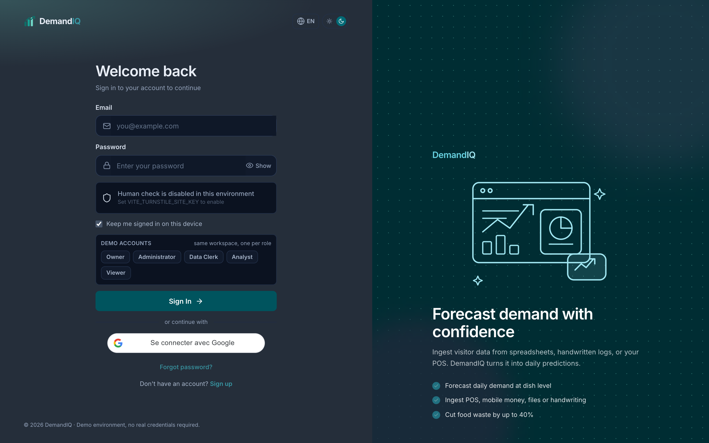 | 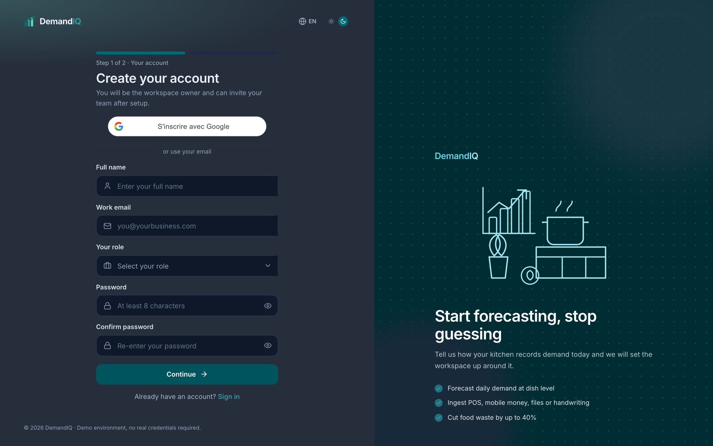 |

### Forecasting and analytics

| Overview | Demand forecast |
| --- | --- |
| 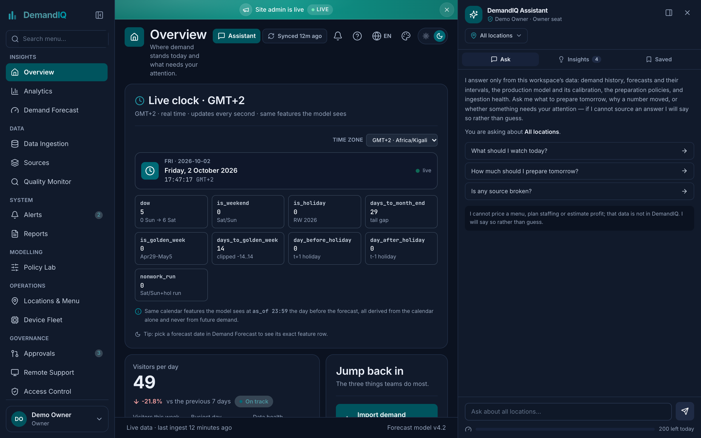 | 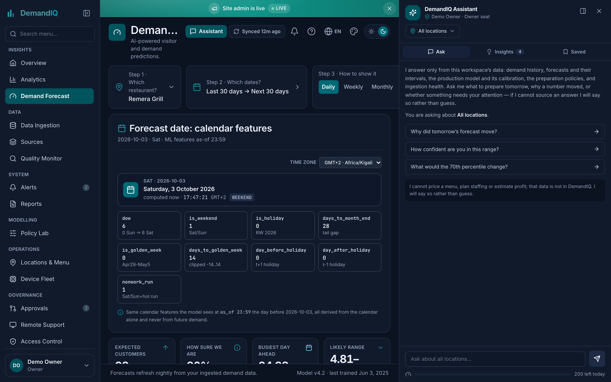 |

| Analytics | Data ingestion |
| --- | --- |
| 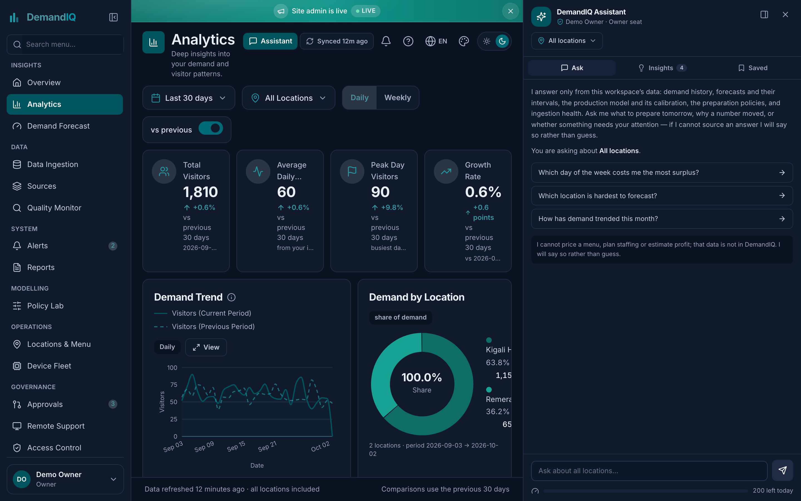 | 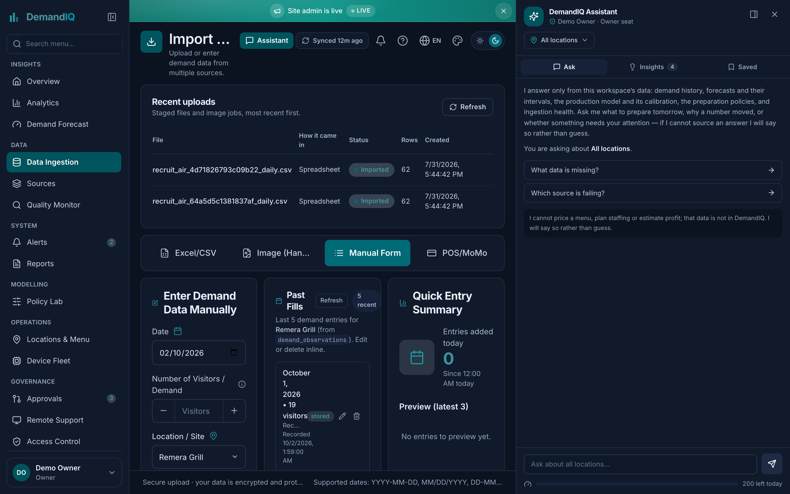 |

### Operations

| Reports | Alerts |
| --- | --- |
| 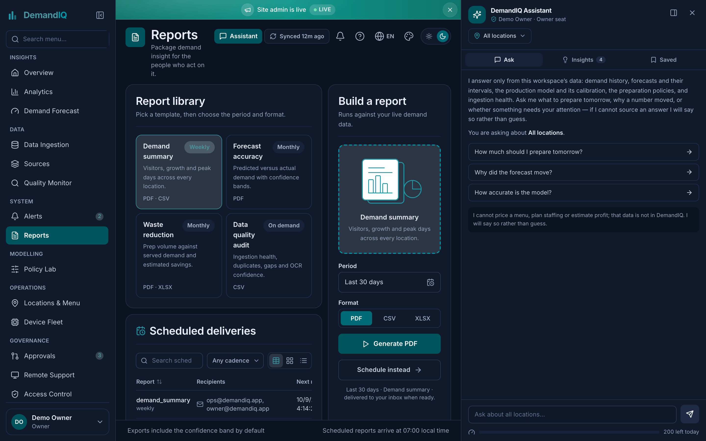 | 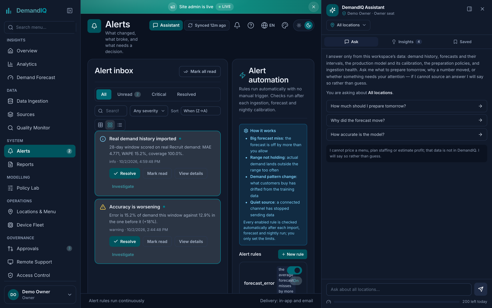 |

### Settings — security, sessions, MFA and account deletion

| Settings |
| --- |
| 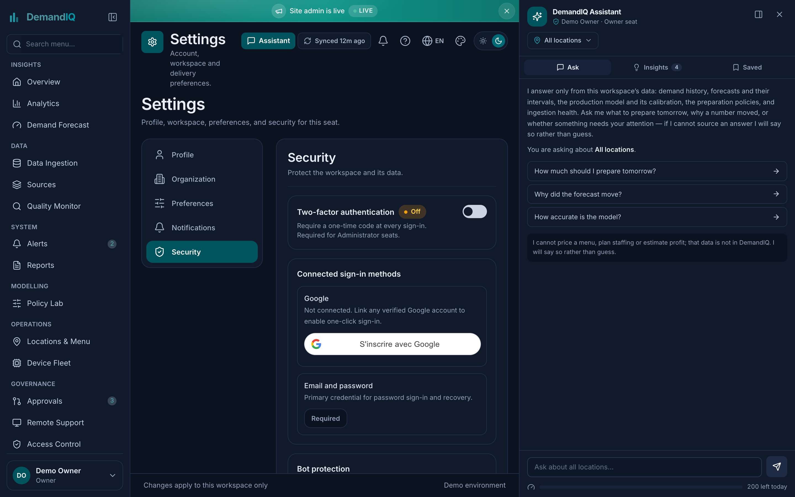 |

---

## UI design

Design process, wireframes, style guide and accessibility contract:
**[docs/DESIGN.md](docs/DESIGN.md)**.

Summary of the reasoning:

- **Three-column shell** — sidebar (navigation), content, assistant rail. Below
  `xl` the rail becomes an overlay drawer; below `md` the sidebar becomes a bottom
  sheet, because an operator opening the app one-handed cannot reach a side drawer.
- **Neutral default palette.** A brand colour that reads as "good" would pre-judge
  the forecast before the operator has seen the interval. Green and red are
  reserved for the *delta*, never for chrome.
- **Interval beside the point estimate, never below the fold.** The commonest way
  a forecasting tool misleads is showing a number and burying its uncertainty.
- **One dialog contract** — focus trap, focus restore, Escape, scroll lock — shared
  by every modal including the ones that own their own layout.
- **Drift and data-quality states are designed surfaces**, not error pages. A model
  that has stopped being trustworthy has to say so in the layout.

Tokens, the type scale and contrast rules are enforced as tests, not conventions:
`frontend/src/__tests__/contrast.test.ts`, `typeScale.test.ts`.

> Figma source files are **not** committed. The wireframes in `docs/DESIGN.md` are
> ASCII, produced alongside the components rather than as upstream design files.

---

## Frontend code

React 18 + TypeScript (strict) + Tailwind + Recharts + Framer Motion.

### Responsive layout

Three breakpoints, and the shell stays mounted so navigation only swaps content —
no reflow, no focus loss:

```tsx
// frontend/src/components/AppShell.tsx
<div className="app-viewport flex w-full overflow-hidden bg-slate-50 text-slate-900">
  <Sidebar
    activeItemId={navRoot}
    onSelect={onNavigate}
    collapsed={collapsed}                 // 236px expanded, 72px collapsed
    badges={badges}
    onToggleCollapsed={() => setCollapsed((value) => !value)}
  />

  <div className="flex min-w-0 flex-1 flex-col overflow-hidden">
    <SiteBanner />
    <PageHeader title={meta.title} subtitle={meta.subtitle} icon={meta.icon} />

    {/* min-w-0 is what stops a wide Recharts canvas forcing page-level
        horizontal scroll; overscroll-contain keeps the scroll inside. */}
    <main className="min-h-0 flex-1 overflow-x-hidden overflow-y-auto
                     overscroll-contain px-3 pb-6 pt-3 sm:px-4 sm:pb-5 lg:px-5">
      <motion.div
        key={activeNavId}
        initial={reduced ? false : { opacity: 0, y: 8 }}
        animate={{ opacity: 1, y: 0 }}
        transition={{ duration: 0.2, ease: [0.23, 1, 0.32, 1] }}
      >
        {children}
      </motion.div>
    </main>

    <PageFooter>…</PageFooter>
    <MobileNav activeItemId={navRoot} onSelect={onNavigate} badges={badges} />
  </div>

  <AgentPanel activeNavId={activeNavId} onNavigate={onNavigate} />
</div>
```

Navigation switches at the `md` breakpoint, in CSS rather than a JS media query —
no hydration mismatch, no layout flash:

```tsx
// frontend/src/components/Sidebar.tsx — hidden below md
'hidden shrink-0 flex-col overflow-hidden border-r border-slate-200 bg-white
 pb-3 pt-4 transition-[width] duration-200 ease-out md:flex'
collapsed ? 'w-[72px] px-2' : 'w-[236px] px-3'

// frontend/src/components/MobileNav.tsx — bottom bar + sheet below md
'fixed inset-x-0 z-50 flex h-[60px] shrink-0 items-stretch
 border-t border-slate-200 bg-white px-1 md:hidden'      // safe-area padded
'safe-bottom-offset fixed inset-x-0 z-40 max-h-[70vh] overflow-y-auto
 rounded-t-2xl border-t bg-white p-3 shadow-[0_-8px_24px_rgba(15,23,42,0.08)]
 md:hidden'
```

### DOM manipulation

One hook owns the entire dialog contract. It exists because two surfaces had
each re-implemented part of it — the legal reader had Escape and the scroll lock
but no focus trap, and the welcome sheet declared `aria-modal` with none of it:

```ts
// frontend/src/components/ui/useDialogBehaviour.ts
export function useDialogBehaviour(open: boolean, onClose: () => void) {
  const panelRef = useRef<HTMLDivElement>(null);

  // Callers pass an inline arrow for `onClose`, so its identity changes every
  // render. Reading it through a ref keeps the effect tied to `open` alone —
  // otherwise every keystroke re-ran the effect and pulled focus back to the
  // dialog, so a typed field only ever kept its first character.
  const closeRef = useRef(onClose);
  useEffect(() => { closeRef.current = onClose; }, [onClose]);

  const previouslyFocused = useRef<HTMLElement | null>(null);

  useEffect(() => {
    if (!open) return;
    previouslyFocused.current = document.activeElement as HTMLElement | null;

    const focusable = () =>
      Array.from(panelRef.current?.querySelectorAll<HTMLElement>(
        'a[href], button:not([disabled]), textarea:not([disabled]), ' +
        'input:not([disabled]), select:not([disabled]), ' +
        '[tabindex]:not([tabindex="-1"])',
      ) ?? []);

    const onKey = (event: KeyboardEvent) => {
      if (event.key === 'Escape') { closeRef.current(); return; }

      // Keep Tab inside the dialog. Without this the focus walks into the page
      // behind the overlay — visually hidden, but still keyboard-live.
      if (event.key !== 'Tab') return;
      const items = focusable();
      const panel = panelRef.current;
      if (items.length === 0) { panel?.focus(); event.preventDefault(); return; }

      const first = items[0];
      const last = items[items.length - 1];
      const active = document.activeElement as HTMLElement | null;
      const inside = Boolean(panel && active && panel.contains(active));
      if (event.shiftKey && (active === first || !inside)) {
        event.preventDefault(); last.focus();
      } else if (!event.shiftKey && (active === last || !inside)) {
        event.preventDefault(); first.focus();
      }
    };

    document.addEventListener('keydown', onKey);
    panelRef.current?.focus();                        // land keyboard users inside
    const previousOverflow = document.body.style.overflow;
    document.body.style.overflow = 'hidden';          // scroll lock
    return () => {
      document.removeEventListener('keydown', onKey);
      document.body.style.overflow = previousOverflow;
      previouslyFocused.current?.focus?.();           // return focus to trigger
    };
  }, [open]);

  return panelRef;
}
```

Other direct-DOM surfaces: `contexts/ThemeContext.tsx` (class-based dark mode),
`contexts/ToastContext.tsx` (live-region announcements), and the Recharts
forecast components in `components/forecast/`.

### Charts

`components/forecast/` — `ForecastChart`, `DemandDistributionChart`,
`WeekdayProfileChart`, `ForecastByDayChart`, `ForecastWhy`, `PreparePanel`.
The interval is drawn as a band under the point series, never as separate bars.

---

## Backend code

Python 3.11 + FastAPI + SQLAlchemy 2.0 + Alembic. 179 API paths / 215 operations
across 31 routers.

### Session lifecycle

One dependency, used by every route. The session is closed after the request and
rolled back on an unhandled exception, so no route can leak a transaction:

```python
# backend/app/database.py
def get_db() -> Generator[Session, None, None]:
    """FastAPI dependency that yields a database session.

    The session is closed automatically after the request, and rolled back
    on unhandled exceptions.
    """
    factory = get_session_factory()
    db: Session = factory()
    try:
        yield db
        db.commit()
    except Exception:
        db.rollback()
        raise
    finally:
        db.close()
```

### Tenant-scoped endpoint with cursor pagination

The tenancy filter is not a middleware or a global scope variable — it is the
first clause of every query, so a route that forgets it fails loudly in review
rather than silently leaking another workspace's rows:

```python
# backend/app/routers/forecasts.py
@router.get("", response_model=dict)
def list_forecasts(
    request: Request,
    db: Annotated[Session, Depends(get_db)],
    current_user: Annotated[User, Depends(get_principal)],
    location_id: uuid.UUID | None = Query(default=None),
    from_date: datetime.date | None = Query(default=None, alias="from"),
    to_date: datetime.date | None = Query(default=None, alias="to"),
    cursor: str | None = Query(default=None),
    limit: int = Query(default=20, ge=1, le=100),
) -> dict[str, Any]:
    """List forecasts for the workspace (optionally filtered by location/date range)."""
    q = select(Forecast).where(Forecast.workspace_id == current_user.workspace_id)

    if location_id is not None:
        loc = db.get(Location, location_id)
        # Cross-tenant probe returns the same 404 as a missing row, so the
        # endpoint does not confirm that another workspace's ID exists.
        if loc is None or loc.workspace_id != current_user.workspace_id:
            raise _error(404, "not_found", "Location not found", field="location_id")
        q = q.where(Forecast.location_id == location_id)

    if from_date is not None:
        q = q.where(Forecast.target_date >= from_date)
    if to_date is not None:
        q = q.where(Forecast.target_date <= to_date)

    if cursor:
        ts, fid = _decode_cursor(cursor)
        q = q.where(Forecast.created_at < ts)

    # Keyset pagination, not OFFSET: stable while rows are inserted, and it does
    # not degrade as the table grows. Fetch limit+1 to detect a next page.
    q = q.order_by(Forecast.created_at.desc(), Forecast.id.desc()).limit(limit + 1)
    rows = list(db.scalars(q).all())
    has_more = len(rows) > limit
    page = rows[:limit]
    next_cursor = (
        _encode_cursor(page[-1].created_at, page[-1].id) if has_more and page else None
    )
    …
```

### Serving logic — adaptive conformal inference

Server-side, not in the notebook. The interval is recomputed per location and per
demand bucket from state that the app maintains at serving time
(`backend/app/services/forecasting/conformal.py`):

```python
def _bucket_index(conf: dict, point: float) -> int: …
def _half_width_from_state(conf, point, state=None) -> float | None: …
def record_conformal_outcome(…):
    def _upd(alpha: float) -> float: …
```

Mondrian bucketing means a quiet Tuesday and a busy Saturday get different
interval widths — the alternative is one global quantile that is over-wide
everywhere it is not needed.

### Other server-side surfaces

| Area | Path |
| --- | --- |
| Routers (31) | `app/routers/` — auth, ingest, forecasts, policies, quality, alerts, reports, devices, agent, site_admin … |
| Forecasting services | `app/services/forecasting/` — `bundle`, `loader`, `conformal`, `generate`, `persist` |
| Auth / crypto | `app/security/` — JWT issue+rotate, bcrypt, Turnstile, Google JWKS, rate limits |
| Middleware | `app/middleware/audit.py`, `maintenance.py` |
| ORM | `app/models/` — 52 tables |

Full endpoint reference: [backend/API_ENDPOINTS.md](backend/API_ENDPOINTS.md).
Interactive: `/docs` (Swagger UI) or `/redoc`.

---

## Database schema and data model

PostgreSQL 15 with `citext` and `pgcrypto`. **52 tables**, created by 19 Alembic
revisions (`001_initial` → `018_dark_theme_default`); migrations are authoritative,
`database/schema.sql` and `database/AGENT_SCHEMA.sql` are a readable reference.

### Domains

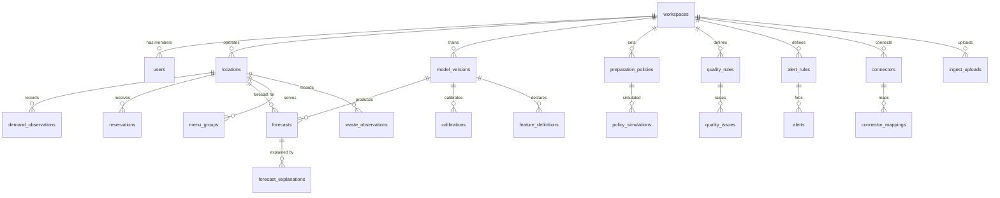

### The forecast fact chain

The core path, which is what the ML pipeline produces:

```
demand_observations ──► features (fs-2026.09.2) ──► model_versions
                                                     │
                          forecasts ◄────────────────┘
                             │
                             ├──► forecast_explanations   (SHAP contributions)
                             └──► policy_simulations       (prepared / surplus / unmet)

calibrations  ── adaptive conformal state per location + demand bucket
```

| Table | Purpose |
| --- | --- |
| `demand_observations` | One row per location per day. The training target. |
| `model_versions` | Which booster, which feature set version, trained-at. |
| `feature_definitions` | The 26 features, versioned — so a forecast can name its contract. |
| `forecasts` | Point + interval, tagged with the `model_version_id` that served it. |
| `forecast_explanations` | Per-driver attribution behind each forecast. |
| `calibrations` | Mondrian conformal state, per location and demand bucket. |
| `preparation_policies` / `policy_simulations` | Prepared, surplus, unmet per scenario. |
| `waste_observations` | Waste side, kept **separate** from demand — never joined. |
| `quality_rules` / `quality_issues` | Data-quality state surfaced in the UI. |
| `audit_log` | Every privileged mutation. |

### Conventions worth noting

- **`workspace_id` on every tenant table**, `ondelete="CASCADE"` from
  `workspaces`. Account deletion is a real cascade, not a soft flag.
- **`point_forecast` is `numeric(14, 2)`**, not a float and not a guessed width —
  sized to hold the whole range of `demand_qty` (an `integer`) with room for the
  interval margin. See migration `015`.
- **`alembic_version` is not the source of truth for review** — `database/schema.sql`
  is a generated reference and has drifted slightly from the migrations.

---

## ML model and notebook

`model/notebooks/DemandIQ-01-Data-and-Baseline.ipynb` — 13 cells, runs end to end
locally or on Colab, checkpoints after every stage so a re-run is nearly free.

### Data visualisation and engineering

Five figures in `model/figures/nb01/`:

| Figure | What it shows |
| --- | --- |
| `fig_target.png` | Target distribution raw vs log1p, and mean demand by weekday |
| `fig_target_justification.png` | The transform and the weekday claim, measured |
| `fig_corr_missing.png` | Spearman correlation among 26 features; structural nullity |
| `fig_waste.png` | URBAN-WASTE distribution, per-city spread, rolling trend |
| `fig_architecture.png` | Fitted booster parameters and gain importance |

**Data.** Recruit (Kaggle, research use): 252,108 store-days, 829 stores,
2015-07-01 → 2018-10-31, across 4 CSVs. 26 features, version `fs-2026.09.2`.

**Feature engineering.** Historical lags (1/7/14) and rolling windows computed on
`shift(1)` — past data only, never the forecast day. `dow_mean_8w` is the mean of
the same weekday over its last 8 occurrences. A leakage gate blocks training if any
feature would read the future.

**Structural missingness is never imputed.** A young store has no history; only
37.9% of stores have a reservation feed. Imputing would teach the model that a
store with no reservation data has zero bookings. LightGBM routes nulls down its own
learned branch.

**Why log1p.** The raw target is right-skewed — skew 2.69, excess kurtosis 39.9 — so
squared error would be dominated by a few hundred extreme days. Log1p cuts skew to
−0.45, and makes the loss proportional to *relative* error. log1p rather than plain
log because ~0.9% of store-days record zero visitors and `log(0)` is undefined.
The cost is stated, not hidden: `expm1` returns a geometric mean, so predictions run
about 8% low (bias −1.67 visitors).

### Model architecture

Gradient boosting, not a neural network. The mapping is explicit because the
architecture write-up asks for it:

| Term | DemandIQ equivalent |
| --- | --- |
| Layer | One boosting round; the ensemble is the sum of `T` trees |
| Activation | Split + leaf value per tree |
| Optimisation | Gradient descent on the learning rate, `lr = 0.05` |
| Objective | Least squares on `log1p` targets |
| Regularisation | `feature_fraction = 0.9`, min-data-in-leaf, early stopping |

- **Primary — LightGBM**: leaf-wise trees, 200 rounds after early stopping on the
  last 10% of the *training* window (the held-out window is never used for stopping).
- **Secondary — CatBoost**: symmetric depth-6 trees with ordered target statistics,
  868 rounds. A genuinely different architecture on identical rows and features.
- **Fallbacks** — XGBoost and random forest, on the same data, so a simpler model
  can beat the complex ones.
- **Conformal** — Mondrian adaptive intervals, recalibrated at serving time.
- **Explainability** — SHAP over every served forecast.

### Performance metrics

All on one held-out window, `visit_date >= 2017-02-01`, 57,866 rows. Seed 42.

| Model | MAE | RMSLE | MASE | R² | Bias |
| --- | --- | --- | --- | --- | --- |
| baseline: global_average | 12.759 | 0.8630 | 1.2080 | −0.001 | −0.479 |
| baseline: historical_average | 8.846 | 0.6297 | 0.8375 | 0.342 | −1.412 |
| baseline: weekday_mean | 7.667 | 0.5728 | 0.7259 | 0.472 | −0.410 |
| fallback: linear_regression | 8.921 | 0.5503 | 0.8440 | −1.103 | −1.146 |
| fallback: random_forest | 6.764 | 0.4958 | 0.6400 | 0.570 | −2.329 |
| fallback: xgboost | 6.684 | 0.4933 | 0.6324 | 0.580 | −1.670 |
| **lightgbm** | **6.702** | 0.4934 | 0.6340 | 0.582 | −1.668 |
| **catboost** | **6.690** | 0.4937 | 0.6329 | 0.580 | −1.719 |

**LightGBM MAE 6.702 vs the best baseline (weekday_mean) 7.667 — a 12.6% lift.**

Reported honestly: the three boosters span 0.018 MAE, which is noise, and the
XGBoost *fallback* scored marginally best. The defensible claim is "gradient
boosting beats a strong baseline by ~13%; which implementation you pick does not
matter." Bias is negative because of the log round-trip — disclosed, not corrected.

Conformal prediction: target coverage 0.90 → **empirical 0.8998**, mean interval
width 29.62 visitors. Coverage degrades with demand — 94.7% (0–15), 90.6% (15–30),
84.8% (30–60), **56.1% (60+)**.

Staffing policy: 4.6% lower unmet demand than the point forecast, at ~47,835
visitor-equivalents of extra surplus.

Provenance is recorded per stage: library versions, seed, and the SHA-256 of every
source CSV, in `model/artifacts/runs/nb01/manifest.json`.

### Deployment option

- **Web interface** — React SPA, screenshots above.
- **API UI** — Swagger UI at `/docs`, ReDoc at `/redoc`, static OpenAPI at
  `/openapi.json`.
- **Serving bundle** — `model/artifacts/runs/demandiq-nb01-42.zip` (26 MB): parquet
  checkpoints, manifest, model binaries. Loaded by
  `backend/app/services/forecasting/bundle.py`. A configured-but-unloadable bundle
  is a configuration error — the app refuses to boot and `/api/v1/health` answers
  `503`.

---

## Architecture

### System topology

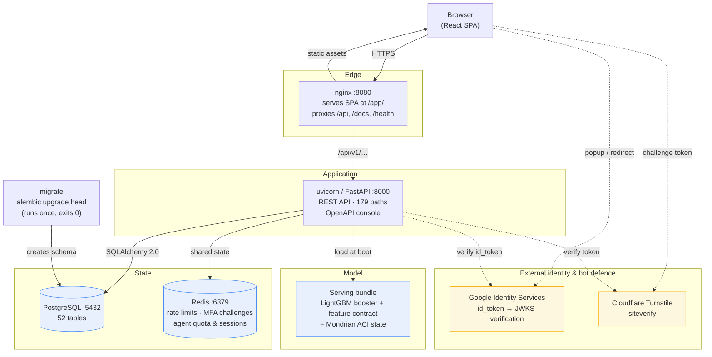

`migrate` runs to completion before the API is allowed to start
(`depends_on: condition: service_completed_successfully`), so there is never a window
where the API serves requests against a database with no tables.

### Authentication flow

```mermaid
sequenceDiagram
    autonumber
    participant U as Browser
    participant A as FastAPI
    participant R as Redis
    participant P as PostgreSQL

    U->>A: POST /auth/login {email, password}
    A->>A: verify_turnstile (skipped when TURNSTILE_SECRET unset)
    A->>P: fetch user by email
    A->>A: bcrypt verify
    alt MFA enabled
        A->>R: store MFA challenge
        A-->>U: 202 {challenge_id}
        U->>A: POST /auth/mfa/verify {code}
    end
    A->>A: issue access JWT (15 min) + refresh JWT
    A->>P: store refresh hash + session row
    A-->>U: tokens
    Note over U,P: tokens live in localStorage;<br/>Bearer on every request

    U->>A: GET /api/v1/… (Bearer)
    alt token valid
        A-->>U: 200
    else 401
        A-->>U: 401
        U->>A: POST /auth/refresh (single-flight)
        A->>P: rotate refresh hash, revoke old session
        A-->>U: new tokens
    end

    U->>A: DELETE /me/account {confirm:"DELETE", current_password}
    A->>P: null audit_log.actor_id, clear NO-ACTION FKs
    A->>P: delete user (cascades sessions, identities, MFA)
    A->>P: delete workspace if last member
    A-->>U: 204
```

---

## Tech stack

| Layer | Technology |
| --- | --- |
| **Frontend** | React 18, TypeScript (strict), Vite, Tailwind CSS, Zustand, Recharts, QRCode |
| **Backend** | Python 3.11, FastAPI, SQLAlchemy 2.0, Alembic, Pydantic v2, `python-jose`, bcrypt |
| **Database** | PostgreSQL 15 (`citext`, `pgcrypto`) + Redis 7 |
| **Model** | LightGBM, CatBoost, SHAP, scikit-learn, joblib, adaptive conformal inference |
| **Tooling** | ESLint, `tsc --noEmit`, Ruff, Black, mypy, pytest, Vitest, Playwright |
| **Deploy** | Docker + Compose v2.24+, nginx |

---

## Project structure

```
DemandIQ/
├── frontend/          # React + TypeScript — 169 src ts/tsx (223 incl. tests)
├── backend/           # FastAPI — 179 paths (215 ops), 119 py, 31 router modules
│   ├── app/
│   │   ├── routers/   # 31 modules; auth, me, ingest, forecasts, agent, admin…
│   │   ├── security/  # JWT, bcrypt, Turnstile + Google verification, rate limits
│   │   ├── models/    # SQLAlchemy ORM
│   │   └── services/  # Forecasting, policy, reporting, drift, ingestion
│   ├── migrations/    # Alembic 001_initial → 018_dark_theme_default (19 revisions)
│   └── API_ENDPOINTS.md
├── model/             # ML pipeline — `diq_model` package (src layout), Colab training
├── database/          # Readable schema reference — schema.sql + AGENT_SCHEMA.sql
│                      # (Alembic migrations are authoritative; 52 tables)
├── scripts/           # dev.sh / verify.sh — dev, verify, sync:console
├── shared/            # Shared types and utilities
├── docs/screenshots/  # README screenshots
└── package.json       # Root monorepo scripts
```

---

## Code files

Where to look for each thing the assignment asks about.

### Frontend — `frontend/src/`

| Path | What it demonstrates |
| --- | --- |
| `components/AppShell.tsx` | Responsive three-column shell, persistent navigation |
| `components/MobileNav.tsx` | Bottom bar + bottom sheet below `md` |
| `components/Sidebar.tsx` | Collapsible sidebar, 236px ↔ 72px |
| `components/ui/useDialogBehaviour.ts` | DOM: focus trap, focus restore, Escape, scroll lock |
| `components/ui/` (`Modal.tsx`, `InlineEdit.tsx`, `CalendarClock.tsx`) | Dialog contract, inline editing, date/time control |
| `components/forecast/` | Recharts forecast, distribution, weekday profile, "why" panel |
| `components/agent/` | Assistant panel — docked column at `xl`, overlay drawer below |
| `contexts/ThemeContext.tsx` | Class-based dark mode (DOM class on `<html>`) |
| `contexts/ToastContext.tsx` | Live-region toast announcements |
| `lib/`, `hooks/` | API client, formatting, data hooks |
| `__tests__/` | Vitest + Testing Library; `contrast.test.ts`, `typeScale.test.ts` enforce the design system |
| `frontend/e2e/route-smoke.mjs` | Route smoke test |

### Backend — `backend/app/`

| Path | What it demonstrates |
| --- | --- |
| `routers/` (31 modules) | 179 API paths / 215 operations |
| `routers/forecasts.py` | Tenant-scoped queries, keyset pagination, typed errors |
| `services/forecasting/` | Bundle loading, generation, conformal inference, persistence |
| `services/forecasting/conformal.py` | Mondrian adaptive interval state |
| `database.py` | `get_db` session dependency |
| `models/` | SQLAlchemy 2.0 ORM — 52 tables |
| `security/` | JWT issue/rotate, bcrypt, MFA, Turnstile, Google JWKS, rate limits |
| `middleware/` | Audit trail, maintenance mode |
| `migrations/versions/` | 19 Alembic revisions |
| `tests/` | pytest, including `test_real_serving.py` |

### ML — `model/`

| Path | What it demonstrates |
| --- | --- |
| `notebooks/DemandIQ-01-Data-and-Baseline.ipynb` | The deliverable notebook: 13 cells, 5 figures, checkpoints |
| `src/diq_model/train.py` | Nine-stage pipeline with checkpointing |
| `src/diq_model/features/build.py` | `shift(1)` leakage discipline, 26 features |
| `src/diq_model/models/` | LightGBM, CatBoost, fallback wrappers |
| `src/diq_model/evaluate/metrics.py` | MAE, RMSE, RMSLE, MASE, R², bias |
| `src/diq_model/policy/` | Newsvendor surplus / unmet-demand simulation |
| `src/diq_model/explain/` | SHAP attribution |
| `scripts/analyze_waste.py` | URBAN-WASTE loader and audit gates |
| `figures/nb01/` | Five generated figures |
| `artifacts/runs/nb01/` | Checkpoints, manifest with provenance |

### Database & docs

| Path | Contents |
| --- | --- |
| `database/schema.sql` | Readable schema reference |
| `database/AGENT_SCHEMA.sql` | Assistant quota / session tables |
| `docs/DESIGN.md` | UI design process, wireframes, style guide |
| `docs/screenshots/` | Nine application screenshots |
| `backend/API_ENDPOINTS.md` | Generated endpoint reference |
| `model/FEATURE_SPEC.md` | The 26-feature contract |
| `model/PIPELINE.md` | Stage-by-stage pipeline documentation |

---

## Setup

### Prerequisites

| Requirement | Version | Notes |
| --- | --- | --- |
| Node.js | >= 18.0.0 | npm >= 9 |
| Python | 3.11 | The backend uses `StrEnum` and PEP 604 syntax |
| PostgreSQL | 15 | Needed for the API; `docker compose` can provide it |
| Redis | 7 | Optional — the app falls back to per-process state |
| Docker + Compose | v2.24+ | Only for the container path |

Every external service has a working default, so a local checkout runs without
Docker if Postgres is reachable.

### 1. Install

```bash
git clone https://github.com/kelvintawe12/DemandIQ.git
cd DemandIQ

npm run install:all
```

<details>
<summary>Manual install (if you prefer not to use the workspace scripts)</summary>

```bash
npm install

python3.11 -m venv backend/.venv
source backend/.venv/bin/activate
pip install -e backend

# model pipeline (optional — only needed to train or run the ML tests)
pip install -e "model[model]"
```
</details>

### 2. Configure

Every value has a working default; `backend/.env` is optional.

```bash
cp backend/.env.example backend/.env    # optional
```

The one thing you usually *will* want to set is Google Sign-In. The client ID goes
in **both** files and they must match exactly; the client secret goes in the
backend only, never in a `VITE_*` variable (those are compiled into the public
browser bundle).

```bash
# frontend/.env  — public, compiled into the browser bundle
VITE_API_URL=http://localhost:8000
VITE_GOOGLE_CLIENT_ID=1234567890-abc.apps.googleusercontent.com

# backend/.env   — server-side only
GOOGLE_OAUTH_CLIENT_ID=1234567890-abc.apps.googleusercontent.com
GOOGLE_OAUTH_CLIENT_SECRET=GOCSPX-...
```

Then add `http://localhost:5173` to **Authorized JavaScript origins** for that OAuth
client in the Google Cloud Console, or Google sign-in fails with
`origin_not_allowed`. That is a console setting — no code change can bypass it.

<details>
<summary>Optional variables</summary>

| Variable | Where | Effect when unset |
| --- | --- | --- |
| `TURNSTILE_SECRET` | backend | Turnstile verification is **skipped**; the human check is not enforced |
| `VITE_TURNSTILE_SITE_KEY` | frontend | The widget is not rendered at all |
| `MODEL_BUNDLE_PATH` | backend | Falls back to the deterministic stub; forecasts are filed against `v0-fallback` |
| `REDIS_URL` | backend | Rate limits and MFA challenges fall back to per-process state |
| `SMTP_*` | backend | Email verification and password reset cannot be delivered |

> **Turnstile on IPv4-only networks:** the browser challenge host
> (`brunhild.challenges.cloudflare.com`) is IPv6-only. On an IPv4-only LAN the
> widget never solves and sign-in silently blocks with *"Complete the human check
> to continue."* Leave `TURNSTILE_SECRET` empty there. The server-side
> `siteverify` host has IPv4 and works fine.
</details>

### 3. Database

```bash
cd backend && python3.11 -m alembic upgrade head
```

### 4. Run

```bash
npm run dev
```

This runs `scripts/dev.sh`: starts Postgres + Redis, applies migrations, then starts
`uvicorn` on `:8000` and Vite on `:5173`.

| Service | URL |
| --- | --- |
| Product UI | <http://localhost:5173> |
| API | <http://localhost:8000> |
| OpenAPI docs | <http://localhost:8000/docs> |
| Health | <http://localhost:8000/api/v1/health> |

Sign in with a seeded demo account: `demo@demandiq.app` / `DemandIQ2026!` (Owner).
Per-role accounts are listed on the sign-in screen.

---

## Deployment plan

### Local / demo (containers)

```bash
cp .env.example .env     # optional — every value has a working default
make docker-up           # postgres + redis + migrate + api + web
```

- Product UI: <http://localhost:5173/app/>
- OpenAPI console: <http://localhost:5173>

### Staging

1. Provision Postgres 15 and Redis 7 with automated backups; create a dedicated role
   for the app (not `postgres`).
2. Set a strong `JWT_SECRET` (≥ 32 chars, generated — the dev default is rejected in
   production).
3. Set `CORS_ORIGINS` to the exact deployed origins. The default is `["*"]`, which
   must not survive into production.
4. Set `TURNSTILE_SECRET` **and** `VITE_TURNSTILE_SITE_KEY` to a real pair from the
   Cloudflare dashboard. Test keys always pass and are rejected in production.
5. Set `GOOGLE_OAUTH_CLIENT_ID` / `GOOGLE_OAUTH_CLIENT_SECRET`; register the staging
   origin in Authorized JavaScript origins.
6. Export the model serving bundle and mount it, then set `MODEL_BUNDLE_PATH`. A
   configured-but-unloadable path is a hard boot failure by design.
7. Deploy behind TLS termination; publish **only** the web port and keep the API
   port internal.
8. If you terminate TLS at a proxy, set `TRUSTED_PROXY_HEADERS=true` so rate limiting
   sees real client IPs instead of the proxy's.

### Production

| Concern | Requirement |
| --- | --- |
| **Secrets** | All secrets from a secret manager, never a committed `.env`. `JWT_SECRET`, `GOOGLE_OAUTH_CLIENT_SECRET`, `TURNSTILE_SECRET`, DB and Redis credentials. |
| **Database** | Automated backups + point-in-time recovery; migrations run as a one-shot job before the new version starts serving. |
| **TLS** | HTTPS only; HSTS; the API port not exposed publicly. |
| **Health** | Liveness on `/health`, readiness on `/api/v1/health` (returns `503` when the serving bundle is broken). |
| **Scaling** | The API is stateless — scale horizontally. Redis keeps rate limits and MFA challenges shared across workers rather than per-worker. |
| **Background jobs** | Run the worker as its own service (`make worker`, Compose profile `worker`) rather than in-process, so a web restart does not interrupt jobs. |
| **Observability** | Audit log for privileged mutations; structured auth logging; `GET /api/v1/health` for monitoring. |
| **Legal** | Account self-erasure is available in Settings → Security → Danger zone. |

### Production checklist

Before go-live, confirm:

- [ ] `APP_ENV=production`
- [ ] `JWT_SECRET` is a strong generated value
- [ ] `CORS_ORIGINS` lists only the real origins (not `*`)
- [ ] `TURNSTILE_SECRET` is a real secret, not a Cloudflare test key
- [ ] `GOOGLE_OAUTH_CLIENT_ID` matches the frontend, and origins are registered
- [ ] `DATABASE_URL` / `REDIS_URL` point at managed services, not localhost
- [ ] Only the web port is published; TLS terminates in front of it
- [ ] Backups are configured **and a restore has been tested**
- [ ] `GET /api/v1/health` returns `200` with `serving.mode != "error"`
- [ ] Demo accounts (`demo@demandiq.app` and the other four) are **removed**

Full guide, topology rationale and troubleshooting: [DOCKER.md](DOCKER.md).

---

## Testing

| Suite | Command | Result |
| --- | --- | --- |
| Backend unit | `make test-backend` | 602 passed, 42 skipped |
| Backend integration | `make test-backend-integration` | ingestion, jobs, and the delete routes |
| Frontend | `npm run test` | 486 passed across 53 files |
| Model | `make test-model` | leakage gate + ML pipeline (needs `model[model]` extras) |
| Auth E2E | `make auth-e2e` | 25 checks on a disposable Postgres with real migrations and real HTTP |
| Lint / types | `make lint-backend lint-frontend typecheck-frontend` | ruff, black, mypy, eslint, `tsc --noEmit` all clean |

One-command verification: `npm run verify`.

Notable guardrails that are enforced as tests rather than conventions:

- **Contrast and type scale** — `frontend/src/__tests__/contrast.test.ts`, `typeScale.test.ts`
- **Leakage gate** — training refuses to run when features leak future information
- **Audit trail survives erasure** — account deletion nulls `audit_log.actor_id` rather than deleting the row
- **Trust ladder** — a new sign-up can never claim a seat above the platform `default_role`
- **Image-leak canary** — CI greps the built image for a `JWT_SECRET` canary to prove `backend/.env` is not baked in

---

## Documentation

- [Backend Architecture](backend/ARCHITECTURE.md)
- [API Endpoints](backend/API_ENDPOINTS.md)
- [Implementation Guide](backend/IMPLEMENTATION_GUIDE.md)
- [ML Pipeline](model/README.md) · [Training on Colab](model/COLAB.md)
- [Database Schema](database/README.md)
- [AI Assistant Design](model/AGENT_DESIGN.md)
- [Design System](docs/DESIGN.md)
- [Containers & Deployment](DOCKER.md)

---

## License

Proprietary — all rights reserved.

## Contact

For questions or support, contact the DemandIQ team.