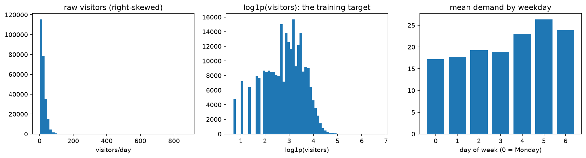
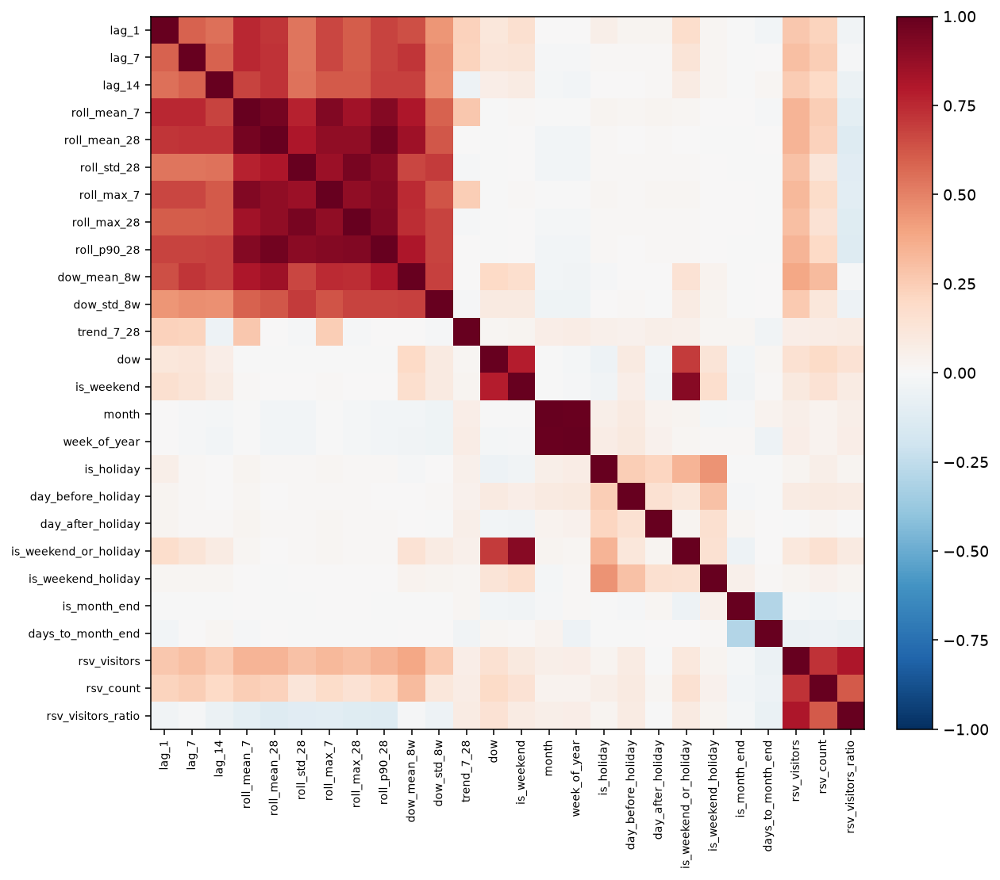
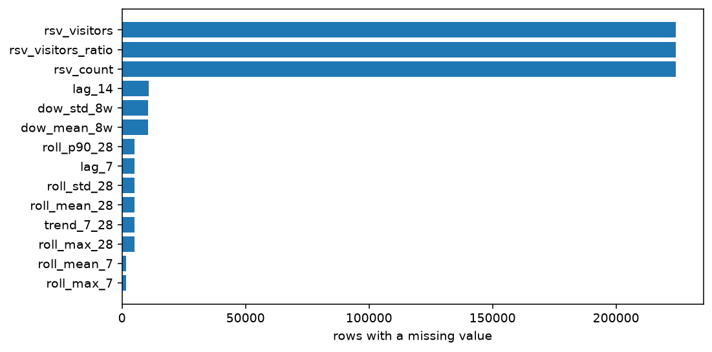
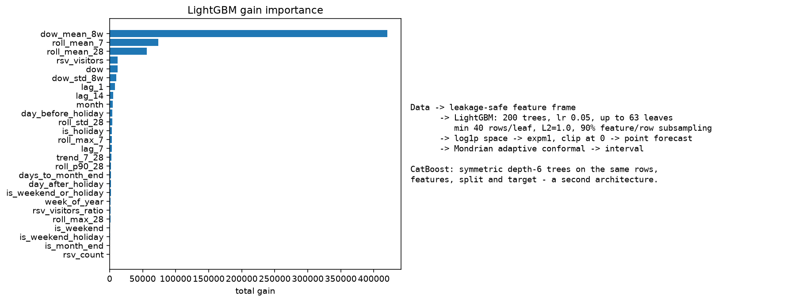

# Chapter 4 — Results and Discussion (draft)

All figures in this chapter are rendered programmatically from the training run's stage manifest (seed **42**), so every number traces to a stage, a seed and a library set — the provenance discipline specified in Section 3.27. The dataset is the Recruit Restaurant Visitor Forecasting corpus: **252,108** daily visit records across **829** restaurants (92,378 reservation records), spanning 2016-01-01 to 2017-04-22, split chronologically at 2017-02-01 for the held-out evaluation window. The audit of Section 3.7.1 passed all 8 checks before any model ran, and the per-store coverage reference figures (mean 85.0%, 210 stores below 80%) were reproduced exactly.

## Model architecture and the training data (Sections 3.10 / 3.13)

The figures below come from the same run as the tables that follow: `features.parquet` for the data and `lightgbm_model.joblib` for the architecture. Nothing is hand-entered, so they cannot drift from the trained model.

**Figure 4.A** — the training target is right-skewed (median 17, 95th percentile 52, maximum 877), which is why the model trains on log1p(visitors) and is scored with RMSLE as its primary comparison.

**Figure 4.B** — Spearman correlation among the 26 leakage-safe features. Several inputs are near-collinear (strongest pairs: `month`/`week_of_year` rho 0.99, `roll_mean_28`/`roll_p90_28` rho 0.96, `roll_mean_28`/`roll_mean_7` rho 0.96), which is why each tree sees a random 90% of features rather than the full correlated set.

**Figure 4.C** — missingness is structural: 14 of 26 features carry nulls (new stores lack history; only about a third of stores have a reservation feed). Nothing is imputed — boosted trees route a NaN down its own branch.

**Figure 4.D** — the model is a gradient-boosted tree ensemble, not a neural network: 200 trees kept of a 2000 ceiling (early stopping, patience 100), learning rate 0.05, up to 63 leaves per tree.

There are no neural layers and no activation functions here: the "layers" are boosting rounds, the activation-function analogue is the learning rate, and optimisation is least-squares on log1p targets, regularised by `min_data_in_leaf`, `lambda_l2` and row/feature subsampling. CatBoost is a genuine second architecture (symmetric depth-6 trees) rather than a re-run, which is why Section 3.13 keeps both.

## 4.1 Predictive accuracy (RQ1)

Section 3.12 requires every candidate to clear a gauntlet of five baselines before it can be considered; a model that cannot beat the strongest simple rule has no place in production. Table 4.1 reports every candidate on the same held-out window — the five baselines, the three Section 3.13 fallback models and the two primaries.

| model              |    mae |   rmse |   rmsle |   mase |   bias |
|:-------------------|-------:|-------:|--------:|-------:|-------:|
| XGBoost            |  6.684 | 11.373 |   0.493 |  0.632 | -1.670 |
| CatBoost           |  6.690 | 11.371 |   0.494 |  0.633 | -1.719 |
| LightGBM           |  6.702 | 11.346 |   0.493 |  0.634 | -1.668 |
| Random Forest      |  6.764 | 11.510 |   0.496 |  0.640 | -2.329 |
| weekday_mean       |  7.667 | 12.757 |   0.573 |  0.726 | -0.410 |
| historical_average |  8.846 | 14.242 |   0.630 |  0.838 | -1.412 |
| Linear Regression  |  8.921 | 25.450 |   0.550 |  0.844 | -1.146 |
| seasonal_naive     |  9.874 | 15.840 |   0.728 |  0.935 | -0.130 |
| naive              | 10.650 | 17.125 |   0.773 |  1.008 | -0.091 |
| global_average     | 12.759 | 17.557 |   0.863 |  1.208 | -0.479 |

**Table 4.1** — Point-accuracy on the held-out window (57,866 store-days). MAE/RMSE/Bias in visitors; RMSLE is the primary comparison metric (Section 3.15); MASE is scaled by the seasonal-naive in-sample MAE so stores of different sizes compare fairly.

The weekday-mean baseline proves the strongest simple rule (MAE 7.67), consistent with the weekday cycle dominating visitor behaviour — and every one of the 5 fitted models except Linear Regression clears it. The single most accurate model on this window is **XGBoost** (MAE 6.684), ahead of CatBoost (6.690) and of its primary counterpart LightGBM (6.702); LightGBM still improves on the best baseline by **12.6%**, with MASE 0.634 comfortably below the 1.0 naive-scale boundary. Section 4.1.1 examines what that ordering means for the Section 3.13 rationale.

One denominator detail belongs in the record. The baselines are scored on 57,873 held-out store-days and every fitted model on 57,866: the 7 extra store-days are a store's FIRST observed day that falls inside the test window, so no prior demand exists to build lag or rolling features from. The feature build drops a store's first day for exactly that reason (829 rows corpus-wide, one per store), and a model with nothing to condition on but the calendar has no forecast for it. The two sets therefore differ by 7 days out of 57,873 (0.012%). Across every other store-day the comparison is like-for-like; on those 7 debut days no member of the fitted set is credited or penalised.

### 4.1.1 The fallback family (Section 3.13)

Section 3.13 keeps Linear Regression, Random Forest and XGBoost "as baselines and fallback models rather than dropped from the study", for two stated reasons: to test whether the primaries' added complexity is justified by the data, and to have a fallback family if the primaries prove unstable. Table 4.2 reports the three on exactly the rows, features, chronological split and log1p target the primaries use, so the estimator is the only variable between them. The stage reports a missing dependency rather than substituting a model; this run recorded 3 of 3 models with 0 skipped.

| model             |   mae |   rmse |   rmsle |   mase |   bias |     r2 |
|:------------------|------:|-------:|--------:|-------:|-------:|-------:|
| XGBoost           | 6.684 | 11.373 |   0.493 |  0.632 | -1.670 |  0.580 |
| Random Forest     | 6.764 | 11.510 |   0.496 |  0.640 | -2.329 |  0.570 |
| Linear Regression | 8.921 | 25.450 |   0.550 |  0.844 | -1.146 | -1.103 |

**Table 4.2** — Section 3.13 fallback models on the held-out window. R² is included because it separates "beats the baseline" from "explains the demand": a negative R² is worse than predicting the training-window mean.

XGBoost is the most accurate single model in the study on this window: MAE **6.684**, ahead of CatBoost (6.690) and of its primary counterpart LightGBM (6.702). Random Forest, the least-tuned member of the family, clears the best baseline by 0.903 visitors. So the three gradient-boosted learners — one fallback and both primaries — agree to within **0.018 MAE**, a spread of 0.3% of their own error, while the two non-boosted members of the family sit clearly behind. Read together, that pattern locates the accuracy in the feature set and the boosting family rather than in any one implementation. That is the conclusion Section 3.13 anticipated — but reached from the opposite direction: the fallback is the winner, not the safety net, so on point accuracy the primaries' added complexity is **not** justified by this window. The primaries remain the production choice for the reasons the rest of this chapter sets out (calibrated intervals, stored attributions, stable tuning), none of which is a point-accuracy claim.

Linear Regression is the one candidate that fails Section 3.12's bar: MAE **8.921** against the best baseline's 7.667, with R² -1.103. It is reported rather than dropped, because "the simplest model in the family does not pay for itself" is precisely the evidence this comparison exists to produce.

One modelling decision has to be disclosed alongside that figure. An unregularised least-squares fit on a log1p target is an *exponential* model, so a feature row outside the support of the training data inverts to an arbitrary magnitude: this window contains one such row, and inverted it predicted 1.8e10 visitors — enough that the single row, not the model, produced the entire reported error (MAE 315,939.97 over the same 57,866 store-days). The fit is unchanged ordinary least squares; only its PREDICTIONS are censored to the target range observed in the fit slice. That bound is learned from the fit slice alone, so it carries no leakage, and it is applied to no other model — the tree ensembles are bounded by construction, so censoring them could only alter a value that was already finite. With the bound, Linear Regression remains the weakest of the fitted models and the only one that trails the best baseline.

### 4.1.2 Sensitivity to the evaluation origin (Section 3.25)

|   fold |   train_days |   test_days |   mae |   rmse |   rmsle |   mase |   bias |    r2 |   coverage |   mean_width |
|-------:|-------------:|------------:|------:|-------:|--------:|-------:|-------:|------:|-----------:|-------------:|
|  1.000 |      447.000 |   21614.000 | 6.884 | 11.802 |   0.495 |  0.658 | -1.749 | 0.593 |      0.893 |       29.296 |
|  2.000 |      433.000 |   21583.000 | 7.101 | 11.296 |   0.497 |  0.681 | -1.733 | 0.618 |      0.875 |       27.925 |
|  3.000 |      419.000 |   21547.000 | 6.893 | 12.323 |   0.487 |  0.659 | -1.885 | 0.559 |      0.883 |       27.869 |
|  4.000 |      405.000 |   21439.000 | 6.510 | 11.368 |   0.482 |  0.620 | -1.776 | 0.559 |      0.888 |       27.125 |
|  5.000 |      391.000 |   21325.000 | 6.383 |  9.530 |   0.490 |  0.604 | -1.330 | 0.629 |      0.917 |       30.605 |
|  6.000 |      377.000 |   21300.000 | 6.232 |  9.338 |   0.500 |  0.586 | -0.731 | 0.628 |      0.947 |       34.953 |

**Table 4.3** — Rolling-origin backtest: six folds, each refitting from scratch and advancing the origin by 14 days.

Mean MAE across folds is **6.667 ± 0.341** against a single-split figure of 6.702: the held-out estimate is not an artefact of one fortunate window, and the small spread (RMSLE 0.4920 ± 0.0067) indicates the model's advantage is stable as the origin moves through the final months of the data.

### 4.1.3 Sensitivity to feature groups and reservation availability (Section 3.25)

Section 3.25 commits to investigating the sensitivity of the results to "feature groups" and to "reservation availability", and Section 3.10 makes reservations supplementary because coverage is partial. Both are answered the same way: refit the SAME primary model — same hyperparameters, same seed, same chronological split, same rows — with one declared group of columns removed, so the only thing that changes is the information available. The groups are declared once in the feature build and the production model's input list is derived from them, so the ablation subsets cannot drift from the columns the model actually reads. Table 4.4 reports the result over the same 57,866 held-out store-days.

| subset              |   features |    mae |   rmse |   rmsle |   mae_delta_vs_full |
|:--------------------|-----------:|-------:|-------:|--------:|--------------------:|
| full                |         26 |  6.702 | 11.346 |   0.493 |               0.000 |
| without_calendar    |         15 |  6.836 | 11.519 |   0.500 |               0.134 |
| without_reservation |         23 |  6.883 | 11.545 |   0.504 |               0.181 |
| without_historical  |         14 | 11.228 | 16.661 |   0.771 |               4.526 |

**Table 4.4** — Leave-one-group-out ablation: the same LightGBM configuration refitted with one declared feature group removed. A positive `mae_delta_vs_full` means the model got worse without the group.

**historical is load-bearing.** Removing its 12 columns raises MAE from 6.702 to **11.228** (+4.526) — a penalty larger than the entire margin by which the primaries beat the best baseline (0.965). Note where that leaves the model: at 11.23 MAE it is worse than every one of the five baselines in Table 4.1. The recent-history features are therefore not an optional refinement of the Recruit signal — for this configuration they are the signal, and the finding is a caution against reading the boosted models' advantage as coming from calendar cleverness rather than from recent demand.

The remaining groups are marginal by comparison (calendar +0.134, reservation +0.181). That ordering is itself informative rather than a null result: the weekday cycle the calendar group encodes is largely recoverable from the historical group's `dow_mean_8w` and `dow_std_8w` — which are also the two highest-ranked features in the attribution of Section 4.4 — so a small calendar delta is evidence of redundancy across groups rather than of irrelevance, and it is one reason these deltas must not be read as each group's total information content.

The named product requirement — Section 3.10's "the production model must not degrade on locations that have no reservation feed" — is reported on its own, because it is a requirement rather than an ablation curiosity. The recorded verdict is **production_model_degrades_without_reservations** on a measured delta of +0.181 MAE (6.883 without the reservation columns against 6.702 with them). Two qualifications keep that verdict honest. First, the test behind the verdict is a strict greater-than-zero on the delta, so it reports the SIGN of the dependence and not its size: 0.181 on a 6.702 baseline is a 2.7% penalty. Second, reservation coverage in this corpus is partial by construction (Section 3.10), which makes a small measured dependence the expected outcome rather than a surprise. The honest reading for deployment is therefore narrower than either extreme: a location with no reservation feed inherits a penalty of roughly 2.7% of baseline error — not none, and not a broken model.

The scope of this experiment is deliberately narrow, and the manifest records it with the result: marginal contribution on this dataset and split; not a causal claim (Section 3.24).

## 4.2 Interval calibration (RQ2)

Adaptive conformal inference (Section 3.16) targets 90% coverage of the held-out days; the production intervals achieve **90.0%** at a mean width of 29.6 visitors. Because an average can conceal failures on busy days, the intervals are STRATIFIED by predicted demand level (Mondrian ACI): one alpha and one residual window per level, so each stratum calibrates on its own scale. Table 4.5 compares the stratified intervals against the single global quantile they replaced.

| realised demand level   |   stratified |   global quantile |
|:------------------------|-------------:|------------------:|
| 0-15                    |        0.947 |             0.953 |
| 15-30                   |        0.906 |             0.921 |
| 30-60                   |        0.848 |             0.821 |
| 60+                     |        0.561 |             0.512 |

**Table 4.5** — Empirical coverage by realised demand level: stratified intervals (production) vs the single global quantile.

On the calibration the procedure directly controls, stratification holds every PREDICTED-demand bucket at target — including predicted-busy days at 90.6% — where the global quantile, calibrated once for all days, covered the days that matter most (realised 60+) only 51.2% of the time; overall width narrows from 31.4 to 29.6 visitors. Only 0.0% of store-days fell back to the global interval for lack of stratum history.

Coverage on days whose REALISED demand exceeded 60 improves more modestly (51.2% → 56.1%): a busy day that the model mis-predicts as quiet is scored with a quiet bucket's bounds, so the residual gap at the top of the distribution now reflects the point forecast's accuracy on rare busy days rather than interval width. The implication is directional: further tail protection must come from better tail prediction (features or models aimed at peak days), not from wider intervals everywhere — which would tax every quiet store-day to insure a few.

## 4.3 The preparation trade-off (RQ2)

Section 3.17's central claim is that the choice of preparation policy is a quantifiable trade-off between surplus and unmet demand, not a search for a single winning rule. Table 4.6 reports the three policies simulated over the same 57,866 store-days, with exposures in visitor-equivalents (never kilograms, per Sections 3.18–3.19).

| policy                 |   days |   prepared_total |   surplus_sr |   surplus_ps |   unmet_ud |   surplus_days |   unmet_days |   ps_per_day |   ud_per_day |
|:-----------------------|-------:|-----------------:|-------------:|-------------:|-----------:|---------------:|-------------:|-------------:|-------------:|
| historical_average-n28 |  57866 |       1153659.93 |    163591.17 |    214764.75 |  296135.82 |          29522 |        28211 |         3.71 |         5.12 |
| point_forecast         |  57866 |       1138526.76 |         0.00 |    145646.89 |  242151.14 |          27300 |        30566 |         2.52 |         4.18 |
| uncertainty_aware-q0.6 |  57866 |       1197394.74 |    114625.75 |    193481.68 |  231117.94 |          31019 |        26847 |         3.34 |         3.99 |
| risk_aware-w1          |  57866 |       1112755.79 |         0.00 |    133855.59 |  256130.80 |          25679 |        32187 |         2.31 |         4.43 |

**Table 4.6** — Simulated exposures per policy over the held-out window.

Preparing exactly to the point forecast is not a neutral act: it leaves 242,151 visitor-equivalents of unmet demand on the table. Section 3.14 forbids tuning the uncertainty-aware policy's padding multiplier on the test window, so it was swept on the validation tail under equal costing (surplus + unmet demand); Table 4.7 reports that sweep.

| padding scale (validation)   |   surplus PS |   unmet UD |   PS + UD |
|:-----------------------------|-------------:|-----------:|----------:|
| q0.6                         |        84955 |      68830 |    153785 |
| q0.7                         |       125360 |      43586 |    168946 |
| q0.8                         |       173871 |      26447 |    200318 |
| q0.9                         |       228805 |      15731 |    244537 |
| q1                           |       288210 |       9486 |    297696 |
| q1.1                         |       350350 |       5977 |    356328 |
| q1.2                         |       414039 |       4016 |    418055 |
| q1.3                         |       478535 |       2863 |    481398 |
| q1.5                         |       608567 |       1596 |    610163 |
| point                        |        58779 |      66366 |    125144 |
| risk_w0.5                    |        32998 |     100540 |    133538 |
| risk_w1                      |        54356 |      70562 |    124917 |
| risk_w2                      |        88041 |      46921 |    134962 |
| risk_w3                      |       115465 |      35695 |    151160 |
| risk_w5                      |       158098 |      24634 |    182732 |

**Table 4.7** — Validation-window sweep of the uncertainty-aware padding multiplier against the point policy, costed as surplus + unmet demand (tuned on validation, never on test).

The uncertainty-aware policy prepares to the conformal upper bound (padding multiplier q0.6, tuned on validation; verdict **risk_aware_preferred_at_w1**) and cuts the point-forecast unmet-demand exposure by **4.6%** — at the cost of 47,835 additional visitor-equivalents of surplus. The frozen historical-average policy sits between the two, but its inflexibility leaves both exposures elevated relative to the forecast-driven rules. Which point on this frontier is preferable depends on the relative cost of waste and stock-out at a given site — the trade-off the dashboard must surface rather than resolve (Section 3.20).

## 4.4 What drives the forecasts (Section 3.24)

| feature      |   mean abs SHAP (visitors) |
|:-------------|---------------------------:|
| dow_mean_8w  |                      8.440 |
| roll_mean_7  |                      2.318 |
| rsv_visitors |                      1.321 |
| roll_mean_28 |                      1.182 |
| dow          |                      1.047 |

**Table 4.8** — Mean absolute SHAP contribution per feature, in visitor units.

The attribution is dominated by dow_mean_8w (8.44 visitors on average), with the recent-demand rollings and calendar effects behind it — an explanation consistent with the weekday-driven structure the baseline gauntlet already revealed. Two integrity notes accompany every use of these values: they are **predictive attributions, not causal effects** (the Section 3.24 disclaimer stored with the artifacts), and they sum to the forecast only up to a median relative error of 12.7%, the local-linearisation cost of converting log-space contributions to visitor units — disclosed here rather than hidden.

## 4.5 Observed waste context (Section 3.21, RQ3)

Section 3.21 requires the URBAN-WASTE Food Tracking Device data (Eriksson & Lindgren (2019), CC BY 4.0) to be analysed strictly independently: it characterises observed food-service waste and is never joined to the Recruit demand data at row level (Figure 4, Section 3.5). The audited file contains 3,321 kitchen-day records from 34 establishments across 6 pilot locations, observed 2018-03-02 to 2018-11-21 in the 2018 pilot season. Table 4.9 reports the Section 3.21 descriptive statistics; Table 4.10 summarises between-location variation.

| statistic                 | value                    |
|:--------------------------|:-------------------------|
| Records                   | 3,321                    |
| Establishments            | 34                       |
| Pilot locations           | 6                        |
| Observation period        | 2018-03-02 to 2018-11-21 |
| Non-missing waste weights | 3,160                    |
| Missing waste weights     | 161                      |
| Mean (kg)                 | 37.8                     |
| Median (kg)               | 21.4                     |
| Standard deviation (kg)   | 45.2                     |
| Minimum (kg)              | 0.0                      |
| 95th percentile (kg)      | 133.6                    |
| Maximum (kg)              | 425.5                    |

**Table 4.9** — Observed food-service waste: descriptive statistics over kitchen-day records (kg). All non-missing weights are non-negative.

Measured waste is strongly right-skewed — mean 37.8 kg against a median of 21.4 kg (SD 45.2) — so a typical kitchen-day discards on the order of twenty kilograms while busy days reach into the hundreds (maximum 425.5 kg; 95th percentile 133.6 kg); only 3 recorded days report a zero weight.

| pilot location   |   records |   mean (kg) |   median (kg) |
|:-----------------|----------:|------------:|--------------:|
| Tenerife         |       904 |        74.9 |          69.8 |
| Copenhagen       |       523 |        28.9 |          28.6 |
| Santander        |       525 |        28.7 |          15.6 |
| Portugal         |       475 |        24.7 |          14.0 |
| Cyprus           |       653 |        13.6 |           8.8 |
| kavala           |        80 |        11.8 |           5.5 |

**Table 4.10** — Observed waste by pilot location (locations ordered by median daily waste; kitchens with at least five waste observations).

Between-establishment variation is wider than any temporal pattern: per-establishment medians span 2.0–124.5 kg across the 31 kitchens with at least five observations, while the monthly medians within the single 2018 season stay within 15.4–43.5 kg — the dominant differences are establishment size and service type, not season. Section 3.7.2's expectation about portion variables is confirmed in the file itself: only 10 records carry any ordered-portion information (9 of them together with a waste weight), far too sparse for supervised modelling — this dataset's role remains descriptive characterisation, never label generation.

These observed quantities give the surplus exposures of Section 4.3 an empirical anchor — comparable establishment types discard on the order of tens of kilograms per kitchen-day — but they contextualise, and do not validate, the simulated visitor-equivalent exposures (Sections 3.18–3.19): no observation-level linkage between the two datasets is performed (Figure 4).

## 4.6 Findings

1. **Gradient boosting clears the gauntlet.** LightGBM improves on the best of five baselines by 12.6% MAE (RQ1), and the rolling-origin backtest shows the advantage is stable across evaluation origins (mean MAE 6.667 ± 0.341). Of the 5 fitted models, 4 clear that bar, and the most accurate model on the window is XGBoost — a Section 3.13 fallback — at MAE 6.684 against LightGBM's 6.702.

2. **The fallback family is not a fallback.** Section 3.13 kept Linear Regression, Random Forest and XGBoost to test whether the primaries' complexity is justified; on point accuracy the answer here is no — XGBoost tops the table (MAE 6.684), while Linear Regression (8.921) is the only fitted model that trails the best baseline. But the three gradient-boosted learners agree to within 0.018 MAE, so the accuracy is a property of the feature set and the boosting family rather than of one library — which is the conclusion §3.13 wanted, arrived at against its expectation (RQ1).

3. **Feature-group sensitivity is sharply asymmetric.** Removing the historical group costs +4.526 MAE and leaves the model worse than every baseline in Table 4.1, while the rest of the ablation moves it by less (calendar +0.134). The reservation group is marginal too (+0.181 MAE, 2.7%), which quantitatively supports Section 3.10's decision to treat it as supplementary — though the recorded verdict is **production_model_degrades_without_reservations**, since that test reads the sign of the dependence rather than its size. (RQ1/§3.25)

4. **Stratified intervals hold calibration per predicted level.** Overall coverage 90.0% against a 90% target at a narrower width than the global quantile, with every predicted-demand bucket at target (predicted-busy: 90.6%); the residual gap on realised-busy days (56%) is a point-forecast limitation, not an interval one (RQ2).

5. **Uncertainty has a price and a payoff.** The uncertainty-aware policy buys a 4.6% reduction in unmet-demand exposure for 47,835 visitor-equivalents of extra surplus (RQ2) — a frontier to be priced per site, not a universal recommendation.

6. **Explanations are auditable.** Feature attributions are stored with each forecast, framed as predictive rather than causal, with a disclosed reconstruction error of 12.7%.

7. **Observed waste is characterised, not fabricated.** The URBAN-WASTE data (3,321 kitchen-days, 34 establishments, 6 pilot locations) show a median daily waste of 21.4 kg (mean 37.8 kg, maximum 425.5 kg) with wide between-establishment variation, and ordered-portion fields too sparse (9 paired observations) for supervised use — the Figure 4 evidence boundary is preserved end to end (RQ3).

## 4.7 Limitations

Three limitations bound these conclusions. First, tail behaviour: stratification restores calibration per predicted level, but days whose realised demand outruns the point forecast inherit a quiet bucket's bounds, so protection on the very busiest days remains partial — a tail-prediction problem, deferred to future work on peak-day features. Second, the exposure model is deliberately coarse — surplus and unmet demand are simulated exposures in visitor-equivalents, not measured waste or lost revenue, so the frontier informs rather than decides. Third, the dataset ends in April 2017 and covers one metropolitan market; the pipeline is reproducible end-to-end (verified to identical metrics on a second platform), but transportability to other markets or post-2017 regimes is untested.

Two further limitations bound the comparisons added above. First, the feature-group deltas are single-split, single-seed marginal contributions in the sense of Section 3.24: a group removed may carry information also present in the groups that remain, so each delta UNDERSTATES that group's total information content and supports no causal reading — the ordering is a statement about this dataset and this split. Second, the fallback comparison runs one configuration per library with no hyperparameter search, because Section 3.13 keeps these models as a design check rather than a benchmark; "XGBoost beat LightGBM by a fraction of a visitor" is therefore a statement about these configurations on this window and must not be read as a ranking of the libraries or as evidence that XGBoost is the better tool.
